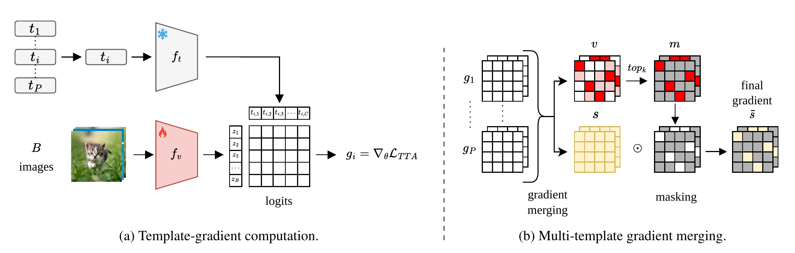

# Sparse Gradient Merging for Test-Time Adaptation of Vision-Language Models

**Accepted at WACV 2027**

[[Paper]](LINK TO PAPER WILL BE ADDED SOON)

This is the official implementation of our WACV 2027 paper.

<p align="center">
  
</p>

**Overview of TTSGM.** (a) Each text template defines class prompts, logits, a TTA loss, and a gradient $g_i$ with respect to the adapted vision-encoder weights. (b) The normalized template gradients $\{g_1, \dots, g_T\}$ are merged into an importance score $v$ and a direction score $s$. The mask $m$ keeps the top-$k$ coordinates of $v$. The final update applies the signed direction only on the masked coordinates.

## Results on Corruption Benchmarks

Accuracy (%) with a ViT-B/32 CLIP backbone. CIFAR-100-C is averaged over its 15 corruptions. Batch size is 128, except for TPT, which uses 32.

| Method | Multi-template | CIFAR-10-C | CIFAR-100-C | Tiny-ImageNet-C |
|---|:---:|:---:|:---:|:---:|
| CLIP | ✗ | 59.26 | 29.44 | 21.38 |
| TENT | ✗ | 67.54 | 35.08 | 22.24 |
| TPT | ✗ | 56.80 | 30.46 | – |
| CLIPArTT | ✗ | 71.11 | 41.43 | 27.51 |
| LoRA | ✗ | 70.89 | 42.14 | 27.49 |
| DoRA | ✗ | 70.92 | 41.99 | 28.31 |
| **TTSGO (ours)** | ✗ | **72.99** | **44.11** | **30.81** |
| WATT-S | ✓ | 73.86 | 45.59 | 33.57 |
| **TTSGM (ours)** | ✓ | **74.80** | **46.85** | **35.42** |

Bold marks the best result within each group (single-template and multi-template). See the paper for results per corruption and on the fine-grained classification datasets.

## Requirements

- Python 3.9
- PyTorch 2.0.1

You can set up the environment with:

```bash
conda env create -f environment.yaml
```

## Datasets

The corruption datasets (CIFAR-10-C, CIFAR-100-C and Tiny-ImageNet-C) can be downloaded with:

```bash
python download_datasets.py --data_dir ./data/
```

To get the fine-grained classification datasets, follow the instructions in the [CLIP-LoRA](https://github.com/MaxZanella/CLIP-LoRA/blob/main/DATASETS.md) repository.

Then set the path to your dataset directory in `./utils/datasets.py`.

## Reproducing the Results

The scripts in the `./bash` directory reproduce the results reported in the paper.

## Acknowledgments

This code builds on the following repositories, and we thank their authors for releasing them:

- [TENT](https://github.com/DequanWang/tent)
- [WATT](https://github.com/Mehrdad-Noori/WATT)
- [CLIP-LoRA](https://github.com/MaxZanella/CLIP-LoRA) (dataset preparation)

## Citation

If you find this work useful, please cite:

```bibtex
@inproceedings{richet2027sparse,
  title     = {Sparse Gradient Merging for Test-Time Adaptation of Vision-Language Models},
  author    = {Richet, Nicolas and Mrabah, Nairouz and Ben Ayed, Ismail and Granger, Eric},
  booktitle = {Proceedings of the IEEE/CVF Winter Conference on Applications of Computer Vision (WACV)},
  year      = {2027}
}
```
